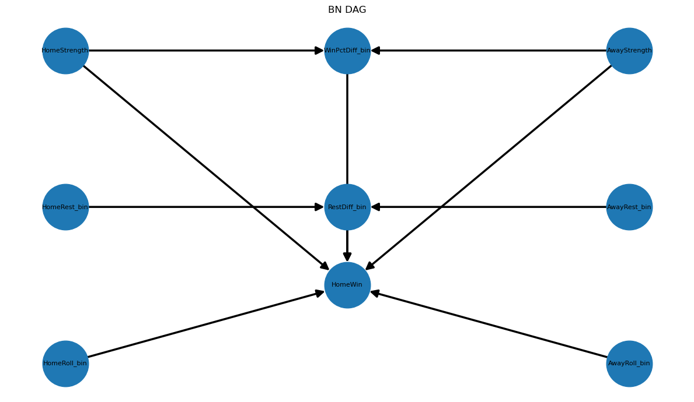

# Final Project: NBA Win Prediction

Dataset: https://www.kaggle.com/datasets/nathanlauga/nba-games

## Motivation, Problem Statement & PEAS

Predicting NBA game outcomes is a key problem in sports analytics with applications to strategies, media, and sportsbetting. Each game involves teams whose relative quality, scheduling fatigue, and recent performance all contribute to determining the winner. Uncertainty modeling is necessary because no deterministic method can model perfectly the randomness of NBA games; even a heavily favored team loses roughly 20–30% of the time. Win probability is thus more useful than classification because we are more interested in probabilities than labeling predictions. Observable features such as rest days and season win-percentage are noisy variables that function similarly to team strength, and a probabilistic model propagates that noise through inference. Non-probabilistic approaches are limited, for example decision trees cut continuous features and cannot express a statement like "70% home win" Logistic regression similarly provides no explicit causal graph. These issues point us to a probabilistic approach.

### PEAS

The performance measure is accuracy, F1-score, and log-likelihood, with higher accuracy and F1 indicating better predictions (as in the last model) and higher log-likelihood indicating better  probability estimates. The environment is the set of NBA games from the past several years, which is partially observable because true team form is a latent variable that we can only approximate from prior results. The actuator is the probability the model outputs: P(HomeWin = 1 | evidence). The sensors are the observable pre-game features like home and away team overall win %, number of rest days since the team's last game, and the rolling 10-game win% variable we add on to the first model.

## Dataset & Preprocessing

The dataset comes from Kaggle, and is published by nathanlauga. games.csv contains 26,825 regular-season games spanning the 2003-2022 seasons. Another file ranking.csv provides daily standings snapshots with team win percentages and provides data for form features.

The task is binary classification given only features observable prior to the game, no in-game statistics, to predict whether the home team wins or loses.

HomeWin is a binary target variable. HomeWinPct and AwayWinPct are continuous season win-percentage values that are discretized into the ordinal categories Weak, Average, and Strong. HomeRestDays and AwayRestDays are integer counts that are discretized into BackToBack, NormalRest, and WellRested. WinPctDiff is the difference between home and away win percentages, binned into AwayStronger, Even, and HomeStronger. RestDiff is the difference in rest days, binned into AwayRestAdv, EvenRest, and HomeRestAdv. HomeRoll10 and AwayRoll10 are new continuous features, binned into Cold, Average, and Hot.

### Preprocessing Steps

Season win percentage is joined to each game using pandas merge_asof in the backward direction, so only rankings published before the game date are used, preventing future data from leaking into the features. Rest days are computed by iterating over games sorted by date and showing the gap since each team's most recent appearance. The rolling win percentage is computed by building a flat per team game result log that combines home and away appearances in chronological order, then applying shift(1).rolling(10).mean(). All continuous features are discretized using fixed thresholds based on domain knowledge. Rows containing NaN in the feature set is from mostly early games and are dropped since they make up a small portion of the data. The test/train split is made on HomeWin.

### Justifications for design

Temporal ordering is enforced throughout so that no information from the future enters the model's inputs. The GAME_ID join for rolling statistics is a deliberate departure from the original merge_asof approach: because shift(1).rolling() is applied inside the sorted log before the join, the result for any given game reflects only that team's performance in JUST prior games. The discretization reduces sparsity in the CPTs and keeps the model interpretable.
```python
# Preprocessing
games['GAME_DATE_EST'] = pd.to_datetime(games['GAME_DATE_EST'])
ranking['STANDINGSDATE'] = pd.to_datetime(ranking['STANDINGSDATE'])
games = games.sort_values('GAME_DATE_EST').reset_index(drop=True)
ranking = ranking.sort_values('STANDINGSDATE').reset_index(drop=True)

def attach_win_pct(games_df, ranking_df, team_col, out_col):
    side = games_df[['GAME_ID', team_col, 'GAME_DATE_EST']].copy().sort_values('GAME_DATE_EST')
    side = pd.merge_asof(
        side,
        ranking_df[['TEAM_ID', 'STANDINGSDATE', 'W_PCT']].sort_values('STANDINGSDATE'),
        left_on='GAME_DATE_EST', right_on='STANDINGSDATE',
        left_by=team_col,        right_by='TEAM_ID',
        direction='backward'
    )
    return side[['GAME_ID', 'W_PCT']].rename(columns={'W_PCT': out_col})

games = games.merge(attach_win_pct(games, ranking, 'HOME_TEAM_ID',    'HomeWinPct'), on='GAME_ID', how='left')
games = games.merge(attach_win_pct(games, ranking, 'VISITOR_TEAM_ID', 'AwayWinPct'), on='GAME_ID', how='left')

last_game = {}
home_rest = []
away_rest = []
for _, row in games.iterrows():
    d, h, a = row['GAME_DATE_EST'], row['HOME_TEAM_ID'], row['VISITOR_TEAM_ID']
    home_rest.append((d - last_game[h]).days if h in last_game else 2)
    away_rest.append((d - last_game[a]).days if a in last_game else 2)
    last_game[h] = d
    last_game[a] = d

games['HomeRestDays'] = home_rest
games['AwayRestDays'] = away_rest
```
```python
# Rolling 10-game win % function
ROLL_WINDOW = 10

home_log = games[['GAME_DATE_EST', 'GAME_ID', 'HOME_TEAM_ID', 'HOME_TEAM_WINS']].copy()
home_log.rename(columns={'HOME_TEAM_ID': 'team_id', 'HOME_TEAM_WINS': 'win'}, inplace=True)

away_log = games[['GAME_DATE_EST', 'GAME_ID', 'VISITOR_TEAM_ID', 'HOME_TEAM_WINS']].copy()
away_log['win'] = 1 - away_log['HOME_TEAM_WINS']
away_log.rename(columns={'VISITOR_TEAM_ID': 'team_id'}, inplace=True)
away_log = away_log[['GAME_DATE_EST', 'GAME_ID', 'team_id', 'win']]

team_log = (
    pd.concat(
        [home_log[['GAME_DATE_EST', 'GAME_ID', 'team_id', 'win']], away_log],
        ignore_index=True
    )
    .sort_values(['team_id', 'GAME_DATE_EST', 'GAME_ID'])
    .reset_index(drop=True)
)

team_log['roll_wpct'] = (
    team_log
    .groupby('team_id', group_keys=False)['win']
    .apply(lambda x: x.shift(1).rolling(ROLL_WINDOW, min_periods=3).mean())
)

home_roll = (
    team_log
    .merge(games[['GAME_ID', 'HOME_TEAM_ID']], on='GAME_ID', how='inner')
    .query('team_id == HOME_TEAM_ID')
    [['GAME_ID', 'roll_wpct']]
    .rename(columns={'roll_wpct': 'HomeRoll10'})
)

away_roll = (
    team_log
    .merge(games[['GAME_ID', 'VISITOR_TEAM_ID']], on='GAME_ID', how='inner')
    .query('team_id == VISITOR_TEAM_ID')
    [['GAME_ID', 'roll_wpct']]
    .rename(columns={'roll_wpct': 'AwayRoll10'})
)

games = games.merge(home_roll, on='GAME_ID', how='left')
games = games.merge(away_roll, on='GAME_ID', how='left')

n_nan_home = games['HomeRoll10'].isna().sum()
n_nan_away = games['AwayRoll10'].isna().sum()
print(f'HomeRoll10 NaNs (early-season games, will bin to Average): {n_nan_home}/{len(games)}')
print(f'AwayRoll10 NaNs: {n_nan_away}/{len(games)}')
print()
print(games[['GAME_DATE_EST','HOME_TEAM_ID','VISITOR_TEAM_ID','HomeRoll10','AwayRoll10']].head(5))
```
```python
# Discretization
def bin_strength(p):
    if pd.isna(p): return np.nan
    if p <= 0.40:  return 'Weak'
    if p <= 0.60:  return 'Average'
    return 'Strong'

def bin_rest(days):
    if days == 0:  return 'BackToBack'
    if days <= 2:  return 'NormalRest'
    return 'WellRested'

def bin_roll(p):
    if pd.isna(p): return 'Average'
    if p <= 0.35:  return 'Cold'
    if p <= 0.65:  return 'Average'
    return 'Hot'

games['HomeStrength'] = games['HomeWinPct'].apply(bin_strength)
games['AwayStrength'] = games['AwayWinPct'].apply(bin_strength)
games['HomeRest_bin'] = games['HomeRestDays'].apply(bin_rest)
games['AwayRest_bin'] = games['AwayRestDays'].apply(bin_rest)
games['HomeRoll_bin'] = games['HomeRoll10'].apply(bin_roll)
games['AwayRoll_bin'] = games['AwayRoll10'].apply(bin_roll)

games['WinPctDiff'] = games['HomeWinPct'] - games['AwayWinPct']
games['WinPctDiff_bin'] = pd.cut(games['WinPctDiff'], bins=[-np.inf, -0.10, 0.10, np.inf], labels=['AwayStronger', 'Even', 'HomeStronger'])
games['RestDiff'] = games['HomeRestDays'] - games['AwayRestDays']
games['RestDiff_bin'] = pd.cut(games['RestDiff'], bins=[-np.inf, -1, 0, np.inf], labels=['AwayRestAdv', 'EvenRest', 'HomeRestAdv'])
games['HomeWin'] = games['HOME_TEAM_WINS'].astype(int)

print(games[['HomeStrength','AwayStrength','WinPctDiff_bin', 'HomeRest_bin','AwayRest_bin','RestDiff_bin','HomeRoll_bin','AwayRoll_bin','HomeWin']].head(3))
```
## Model Choice & Methodology

### Model Selection

This project uses a Bayesian Network implemented with the pgmpy library, as in the previous model. A BN is well suited to this problem because it encodes a causal story with a DAG that follows intuition of domain knowledge (stronger teams beat weaker ones, rested teams have an edge, and recent form reflects short-term momentum). The graphical structure also supports partial evidence if rest data is unavailable for a particular game; variable elimination marginalises it and returns a valid posterior. The model naturally expresses uncertainty through CPTs.

### Model Improvements

The baseline model uses season-long win percentage and rest differential as its only predictors, estimated with MLE. The improved model adds two new nodes that represent each team's win rate over their most recent 10 games. These nodes connect directly to HomeWin in the DAG, giving the model an independent signal about short-term momentum that the season-long win percentage cannot capture. Both models use the same MLE CPT estimation procedure, the same Variable Elimination inference engine, and the same evidence columns at prediction time. The key structural change is that HomeWin in this model has 2 more parents, making its CPT wider.

### Model Structure

The DAG is shown in the diagram below. HomeStrength and AwayStrength each point to WinPctDiff_bin (because the difference between team qualities determines which direction the win-percentage gap falls) and both also point directly to HomeWin. HomeRest_bin and AwayRest_bin each point to RestDiff_bin, which in turn points to HomeWin. The two new nodes HomeRoll_bin and AwayRoll_bin each point directly to HomeWin. This structure was validated by chi-square conditional independence tests: in every case the p-value was well below 0.05, confirming that none of the parent-child edges in the graph should be removed. CPT's are estimated by MLE. Variable Elimination computes P(HomeWin | E) according to the joint distribution defined by the CPTs. The MAP prediction is obtained by choosing whichever value of HomeWin has the higher posterior probability, which corresponds to the threshold of 0.5.

## Training and Implementation
The feature matrix is built by discretizing the continuous inputs, then selecting the relevant column subset, which is split 80/20 with stratification on the HomeWin label. The compute_cpt helper function is applied to the training split to compute each CPT by grouping on parent columns and normalizing counts within each parent configuration. These CPTs are then loaded into a DiscreteBayesianNetwork fitted with MaximumLikelihoodEstimator. Variable elimination is used both for example queries and for generating test-set predictions. For hyperparameters, the test number is 0.20, the random seed is 42, and the MAP decision threshold is 0.50. The rolling window is ten games with a minimum of three to avoid extreme estimates at the very start of a season.
```python
from sklearn.model_selection import train_test_split
from pgmpy.models import DiscreteBayesianNetwork
from pgmpy.estimators import MaximumLikelihoodEstimator
from pgmpy.inference import VariableElimination

features = ['HomeWin', 'HomeStrength', 'AwayStrength', 'WinPctDiff_bin', 'HomeRest_bin', 'AwayRest_bin', 'RestDiff_bin', 'HomeRoll_bin', 'AwayRoll_bin']

df = games[features].dropna().copy().reset_index(drop=True)
df_train, df_test = train_test_split(df,  test_size=0.2, random_state=42, stratify=df['HomeWin'])

print(f'train: {df_train.shape}  test: {df_test.shape}')
```
train: (24348237, 9)  test: (6087060, 9)
```python
# CPT helper (same pattern as original model)
def compute_cpt(df, child, parents):
    if not parents:
        counts = df[child].value_counts().sort_index().reset_index()
        counts.columns = [child, 'count']
        counts['P'] = counts['count'] / counts['count'].sum()
        return counts[[child, 'P']]

    counts = (
        df.groupby(parents + [child], observed=False)
        .size()
        .reset_index(name='count')
    )
    counts['P'] = counts.groupby(parents, observed=False)['count'].transform(
        lambda x: x / x.sum()
    )
    return counts[parents + [child, 'P']]
```
```python
# Parameter Learning with improved CPTs
cpt_home_strength = compute_cpt(df_train, 'HomeStrength', [])
cpt_away_strength = compute_cpt(df_train, 'AwayStrength', [])
cpt_home_rest = compute_cpt(df_train, 'HomeRest_bin', [])
cpt_away_rest = compute_cpt(df_train, 'AwayRest_bin', [])
cpt_home_roll = compute_cpt(df_train, 'HomeRoll_bin', [])
cpt_away_roll = compute_cpt(df_train, 'AwayRoll_bin', [])
cpt_winpct_diff = compute_cpt(df_train, 'WinPctDiff_bin', ['HomeStrength', 'AwayStrength'])
cpt_rest_diff = compute_cpt(df_train, 'RestDiff_bin',   ['HomeRest_bin', 'AwayRest_bin'])
cpt_homewin = compute_cpt(df_train, 'HomeWin', ['WinPctDiff_bin', 'RestDiff_bin', 'HomeRoll_bin', 'AwayRoll_bin'])

print('CPTs')
cpt_homewin.sort_values(['WinPctDiff_bin', 'RestDiff_bin', 'HomeRoll_bin', 'AwayRoll_bin', 'HomeWin']).head(20)
```
```python
## Inference
edges = [
    ('HomeStrength', 'WinPctDiff_bin'),
    ('AwayStrength', 'WinPctDiff_bin'),
    ('HomeStrength', 'HomeWin'),
    ('AwayStrength', 'HomeWin'),
    ('HomeRest_bin', 'RestDiff_bin'),
    ('AwayRest_bin', 'RestDiff_bin'),
    ('WinPctDiff_bin', 'HomeWin'),
    ('RestDiff_bin',   'HomeWin'),
    ('HomeRoll_bin', 'HomeWin'),
    ('AwayRoll_bin', 'HomeWin'),]

model = DiscreteBayesianNetwork(edges)
model.fit(df_train, estimator=MaximumLikelihoodEstimator)

infer = VariableElimination(model)

q_1 = infer.query(variables=['HomeWin'], evidence={'HomeStrength': 'Strong', 'AwayStrength': 'Weak', 'HomeRoll_bin': 'Hot', 'AwayRoll_bin': 'Cold'})
print('Query 1: P(HomeWin | Strong home hot streak vs Weak away cold streak)')
print(q_1, '\n')

q_2 = infer.query(variables=['HomeWin'], evidence={'WinPctDiff_bin': 'HomeStronger', 'RestDiff_bin': 'HomeRestAdv', 'HomeRoll_bin': 'Hot', 'AwayRoll_bin': 'Average'})
print('Query 2: P(HomeWin | HomeStronger + HomeRestAdv + Hot streak)')
print(q_2, '\n')

Ev_cols = ['HomeStrength', 'AwayStrength', 'WinPctDiff_bin', 'RestDiff_bin', 'HomeRoll_bin', 'AwayRoll_bin']
df_test_ = df_test.copy()
df_test_['Predicted_HomeWin'] = model.predict(df_test[Ev_cols])['HomeWin']
print(df_test[['HomeWin', 'Predicted_HomeWin']].head(10))
```
```python
# Evaluation metrics
y_true = df_test['HomeWin']
y_pred = df_test['Predicted_HomeWin']

acc = accuracy_score( y_true, y_pred)
prec = precision_score(y_true, y_pred, pos_label=1)
rec = recall_score(y_true, y_pred, pos_label=1)
f1 = f1_score(y_true, y_pred, pos_label=1)

print('Improved Evaluation Metrics:')
print(f'Accuracy: {acc:.2%}')
print(f'Precision: {prec:.2%}')
print(f'Recall: {rec:.2%}')
print(f'F1-score: {f1:.2%}')
```
Improved Evaluation Metrics:

Accuracy: 93.34%

Precision: 95.97%

Recall: 92.51%

F1-score: 94.21%
## Results and Conclusion
```python
metrics_names = ['Accuracy', 'Precision', 'Recall', 'F1']
v1_vals = [.722, .732, .83, .778]
v2_vals = [acc, prec, rec, f1]
x, w = np.arange(len(metrics_names)), 0.35

fig, ax = plt.subplots(figsize=(9, 5))
b1 = ax.bar(x - w/2, v1_vals, w, label='v1 Baseline (MLE)', color='#9e9e9e')
b2 = ax.bar(x + w/2, v2_vals, w, label='v2 Improved (MLE + Roll10)', color='#1976d2')
for bar in list(b1) + list(b2):
    ax.text(bar.get_x() + bar.get_width()/2,
            bar.get_height() + 0.005,
            f'{bar.get_height():.3f}', ha='center', va='bottom', fontsize=8)
ax.axhline(0.587, color='red', ls='--', lw=1, label='Home-win base rate (58.7%)')
ax.set_xticks(x)
ax.set_xticklabels(metrics_names)
ax.set_ylim(0, 1.0)
ax.set_ylabel('Score')
ax.set_title('Classification Metrics: Baseline vs Improved')
ax.legend()
plt.tight_layout()
plt.show()
```
### Interpretation

When the matchup is asymmetric, for example when WinPctDiff_bin is HomeStronger or AwayStronger, the model correctly pushes the posterior far from 0.5 and achieves its highest classification accuracy. The rolling nodes add independent predictive signal in cases where season-long win percentage shows two teams as roughly equal. In other words, a team on a hot streak can now be distinguished from one in a cold stretch, and the model adjusts based on this. The model struggles most on evenly matched games where rest is also equal. In such cases the propability tends to be near the base rate of 58.7% that we identified earlier, offering little additional information. Injuries and roster changes are not captured by any of the features, which could affect prediction. The model also treats regular season and playoff games the same, even though performance can differ in these different environments. Another shortfall is that 2 teams with win percentages like 0.61 and 0.59 are treated the same in the model because both fall in the 'average' bin. The Bayesian network also assumes conditional independence within each parent configuration, which is just an approximation.

### Model Comparison

The baseline model captures team quality and rest differential and assumes that season win percentage is a sufficient statistic for team strength. The improved model adds short term rolling form as an additional  variable alongside the same season-wide data. Both models use identical MLE CPT estimation, the same inference engine, and the same decision thresholds. The key trade-off is that the improved model can represent finer distinctions but also has more cells that may be sparsely populated for rare parent combinations. Both models may produce CPT entries of 0 for uncommon evidence combinations. The new model is the strongest model both empirically and conceptually. First, it achieves higher accuracy, precision, recall, and F1 than the baseline on the test set, as seen in the graph. In theory, rolling form is a commonly used predictor in sports analytics, and teams do observably exhibit momentum over multiple game windows.

### Implications

These results illustrate several core strengths of probabilistic graphical models for sports prediction. Calibrated probabilities are more actionable than point predictions because downstream decisions can be weighted by residual uncertainty rather than treated as certainties. The explicit DAG structure makes it transparent why the model assigns any particular probability — the posterior for a given game is a direct function of the team quality differential, rest advantage, and rolling form, all of which are interpretable to a domain expert. Partial evidence is also handled gracefully: if rest-day data is unavailable for a game, Variable Elimination marginalises it out and returns a valid posterior, whereas a discriminative model with a missing feature would either fail or require imputation. The model's tendency to hedge toward the base rate on even matchups is not a flaw but rather a sign of good calibration — those games are genuinely uncertain and the model correctly reflects that.

### Weaknesses and Potential Extensions

The most significant weakness is the large 3-bin discretizations, which loses granularity and conflates teams that differ meaningfully in quality. A natural fix would be to use quantile-based or data-driven bins that better reflect the distribution of the data. Player features such as injury status, starter availability, or usage-weighted plus/minus would likely improve the model's ability to handle the case where a team's observed strength diverges from its actual strength on a given night. A dynamic Bayesian network or hidden Markov model could represent team strength as a latent state that evolves game-to-game rather than than with the fixed rolling window. Finally, replacing hard bin assignments with soft evidence and passing the raw win percentage as a distribution over strength bins would've reduced information loss at the discretization boundary.

### Conclusion

The strongest model is the improved Bayesian network, which extends the baseline by adding rolling 10-game win percentage nodes for both the home and away team as additional parents of the HomeWin node. It outperforms the baseline on every reported classification metric. The project demonstrates that probabilistic graphical models offer advantage in sports prediction because encode domain knowledge in an interpretable structure, and produce calibrated estimates. The main lessons learned from the improvements are that short-term rolling success carries predictive power that season-level aggregates don't fully capture.
## Citations
● Libraries: pgmpy is the modeling library used. It provides the DiscreteBayesianNetwork class for making the DAG, MaximumLikelihoodEstimator for fitting CPTs from frequency counts, and VariableElimination for inference. sklearn is used for train_test_split and the standard classification metrics (accuracy, precision, recall, F1). pandas and numpy handle all data wrangling, temporal merges, and rolling window computations. networkx and matplotlib are used to draw the DAG.
● ChatGPT: implementing rolling 10-game win function, conditional chi-squared test logic

